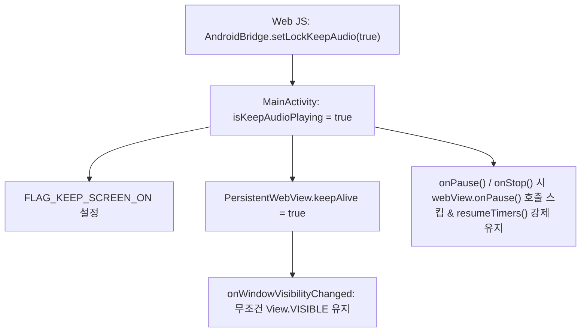
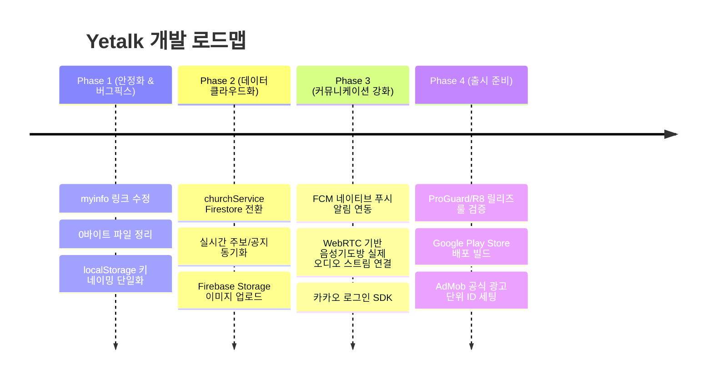

# Yetalk (예톡) 프로젝트 개발 종합 Context

> **문서 버전**: 1.0  
> **기준 일자**: 2026-09-24  
> **패키지명**: `com.example.yetalk`  
> **프로젝트 루트**: `c:\Users\Administrator\AndroidStudioProjects\Yetalk`  

---

## 1. 프로젝트 개요 및 기획 의도

### 1.1 프로젝트 성격
**Yetalk(예톡)**은 **기독교 교회 커뮤니티**와 **지역 기반 단골/비즈니스 미니앱 생태계**를 결합한 하이브리드 모바일 플랫폼입니다.
- **네이티브 안드로이드 쉘 (Native Shell)**: 오디오 셧다운 방어(`PersistentWebView`), 백그라운드 재생, 화면 꺼짐 방지, 인텐트 분기(쿠팡, 카카오톡 등), 네이티브 카메라/파일 선택 처리.
- **웹 프론트엔드 에셋 (HTML5/CSS3/Vanilla ES Modules)**: `app/src/main/assets` 내에 구축된 반응형 Single/Multi-Page Application으로 빠른 UI 변경과 템플릿 확장이 가능한 구조.
- **클라우드 백엔드**: **Firebase (Firestore & Firebase Storage)**를 JS 모듈(`https://www.gstatic.com/firebasejs/12.0.0/`)로 직접 연동하며, 일부 기능은 현재 `localStorage` 기반에서 Firestore 마이그레이션이 진행 중입니다.

---

## 2. 기술 스택 및 개발 환경

### 2.1 안드로이드 네이티브 (Native Environment)
| 항목 | 사양 / 버전 | 비고 |
| :--- | :--- | :--- |
| **OS** | Windows 11 | 개발 호스트 |
| **Android Studio** | `C:\Program Files\Android\Android Studio` | JBR 21 내장 |
| **JDK/JVM** | JetBrains JBR 21 (`21.0.10`) | `JAVA_HOME` 경로 지정 필요 |
| **Gradle** | 9.4.1 | Gradle Wrapper (`gradlew.bat`) |
| **AGP** | 9.2.1 | `com.android.application` |
| **Kotlin** | 2.3.0 | `org.jetbrains.kotlin.android` |
| **Compile / Target SDK** | 36 (minorApiLevel: 1) | 최신 Android API 대응 |
| **Min SDK** | 24 | Android 7.0 (Nougat) 이상 |
| **Java Compatibility** | Java 11 | compileOptions JavaVersion.VERSION_11 |

#### 핵심 네이티브 의존성 (`app/build.gradle.kts`)
- `androidx.webkit:webkit:1.14.0` (안전한 가상 도메인 에셋 서빙: `WebViewAssetLoader`)
- `androidx.core:core-splashscreen:1.0.1` (Android 12+ 스플래시 화면 처리)
- `androidx.activity:activity-ktx:1.8.0` (`onBackPressedDispatcher`, `ActivityResultLauncher`)
- `com.google.android.material:material:1.10.0`
- `androidx.appcompat:appcompat:1.6.1`

### 2.2 웹 프론트엔드 (WebView Assets)
- **언어/런타임**: Vanilla HTML5, CSS3, Modern JavaScript (ES Modules)
- **CDN 라이브러리**:
  - Firebase JS SDK v12.0.0 (`firebase-app.js`, `firebase-firestore.js`, `firebase-storage.js`)
  - YouTube IFrame Player API (`https://www.youtube.com/iframe_api`)
  - Google Fonts (`Pretendard`, `Nanum Myeongjo`)
- **디자인 시스템**:
  - 모바일 뷰포트 최적화 (`width=device-width, user-scalable=no, viewport-fit=cover`)
  - 다크 테마 기본 `#090d16` (예톡 메인 및 교회 메인) + 화이트/핑크 테마 전환 지원
  - 세로 스냅 피드 (`scroll-snap-type: y mandatory`) 기반 숏츠/카드 뷰

### 2.3 Firebase 클라우드 인프라
- **Firebase Project ID**: `yetalk-kr`
- **Auth Domain**: `yetalk-kr.firebaseapp.com`
- **Storage Bucket**: `yetalk-kr.firebasestorage.app`
- **Sender ID**: `1016018270024`
- **Web App ID**: `1:1016018270024:web:ca888bdab48090e457e57d`
- **Android App ID**: `1:1016018270024:android:456f42a0ca12e2ac57e57d`

---

## 3. 핵심 아키텍처 및 네이티브-웹 통신

### 3.1 `PersistentWebView` & 오디오 백그라운드 셧다운 방어
일반적인 Android WebView는 화면 가림(`View.GONE`, 창 최소화, 화면 잠금 등) 시 오디오/비디오 렌더러 타이머를 강제 중지합니다. Yetalk은 설교 말씀이나 찬양을 화면이 꺼진 상태에서도 끊김 없이 들을 수 있도록 독자 설계를 적용했습니다:



### 3.2 AndroidBridge 인터페이스 사양
WebView 내부 JS에서 `window.AndroidBridge`를 통해 네이티브 기능을 즉시 호출할 수 있습니다.

| 메서드 | 매개변수 | 설명 |
| :--- | :--- | :--- |
| `shareToKakaoFriends(message)` | `String` | 카카오톡 패키지(`com.kakao.talk`) 인텐트 호출 (미설치 시 공유 Chooser) |
| `openCamera()` | - | 카메라 인텐트(`ACTION_IMAGE_CAPTURE`) 실행 후 완료 시 JS 콜백 `window.onNativeCameraCaptured()` 실행 |
| `launchCoupangDirect()` | - | 쿠팡 공식 앱 실행 (`com.coupang.mobile`), 없을 시 `coupang://` 스킴 -> 웹 브라우저(`https://www.coupang.com`) 폴백 |
| `setLockKeepAudio(enabled)` | `Boolean` | 화면 고정 플래그 및 백그라운드 오디오 지속 모드 토글 |

### 3.3 로컬 에셋 가상 HTTPS 호스팅 (`WebViewAssetLoader`)
- **접속 주소**: `https://appassets.androidplatform.net/assets/index.html`
- **장점**: `file:///android_asset/` 프로토콜 사용 시 발생하는 CORS 제한, Web Audio API 보안 제약, 로컬 쿠키 및 스토리지 격리 문제를 원천 해결.

---

## 4. 서비스 도메인 및 화면 구조도

```mermaid
graph TD
    Launcher["MainActivity.kt (WebView 쉘)"] --> Index["index.html (예톡 메인 / 숏츠 피드)"]

    subgraph "예톡 플랫폼 (Main Platform)"
        Index --> MyAppHome["myapp_home.html (내앱지갑)"]
        Index --> PayModal["예톡결제 모달"]
        Index --> Community["community.html (예톡Talk 커뮤니티)"]
        Index --> Invite["invite.html (회원 초청)"]
        Index --> CoupangGate["쿠팡 2초 위트 모달 -> 쿠팡앱"]
        Index --> TodayWord["todayword.html (오늘의 말씀)"]
        Index --> DoctorMain["doctormain.html (단골 비즈니스 예: 의원)"]
    end

    subgraph "교회 플랫폼 (Church Platform)"
        Index --> ChurchList["churchlist.html (교회 검색/목록)"]
        ChurchList --> ChurchMain["churchmain.html (예톡행복한교회 메인)"]
        ChurchMain --> C_Intro["churchintro.html (교회의꿈 / 비전)"]
        ChurchMain --> C_Worship["churchworship.html (예배 실황/영상)"]
        ChurchMain --> C_Jubo["churchjubo.html (스마트 주보 1~10면)"]
        ChurchMain --> C_Notice["churchnotice.html (공지알림)"]
        ChurchMain --> C_Pray["churchpray.html (성전 중보기도방)"]
        ChurchMain --> C_Invite["churchinvite.html (교회 초청장)"]
        ChurchMain --> C_Jesus["churchjesuswalking.html (예수동행 나눔터)"]
        ChurchMain --> C_Member["churchmember.html (보배성도 12대 박스)"]
        ChurchMain --> C_NextGen["churchnextgen.html (다음세대)"]
        ChurchMain --> C_Mission["churchmission.html (선교와 전도)"]
        ChurchMain --> C_Archive["churcharchive.html (말씀 보물창고)"]
        ChurchMain --> C_Gospel["church_gospel.html (구원의 복음 사영리)"]
        ChurchMain --> C_Map["church_map.html (오시는 길 / 약도)"]
    end

    subgraph "관리자 및 계정 (Admin & Auth)"
        Index --> Login["login.html (로그인 - Firestore 연동)"]
        Login --> Join["join.html (회원가입)"]
        Login --> MyInfo["myinfo.html (내정보 수정)"]
        Index --> MasterAdmin["admin.html (예톡 통합 마스터 관리자)"]
        ChurchMain --> ChurchAdmin["churchadmin.html (교회 관리자 센터)"]
    end
```



### 4.1 주요 화면 상세 설명

#### 1) 예톡 메인 (`index.html`, `index.js`, `index.css`)
- **헤더 (1층)**: 로고 터치 시 관리자 진입 트리거, 내 정보 태그, 단골 검색 버튼, 쿠팡 바로가기 버튼.
- **네비게이션 (2층)**: 내앱지갑, 예톡결제, 예톡Talk, 초청.
- **3층/고정바**: 단골가기 바, 추천 매장 배지, 화면 고정(오디오 락) 버튼, 영상 추천 버튼.
- **숏츠 피드**: 세로 스크롤 스냅 기반 YouTube 쇼츠 영상 뷰어.
- **위트 모달**: "천국에도 쿠팡이 있을까?" 2초 타이머 카운트다운 모달 -> 쿠팡 앱 직행.

#### 2) 교회 메인 (`churchmain.html`, `churchmain.js`, `churchmain.css`)
- **11대 메인 메뉴 칩**:
  `교회의꿈` | `예배` | `주보` | `공지알림` | `기도모임` | `교회초청` | `예수동행` | `보배성도` | `다음세대` | `선교전도` | `보물창고`
- **하단 5대 고정 네비게이션 (`church_bottom_bar.js`)**:
  `복음` (사영리) | `약도` (오시는 길) | `헌금` (계좌 복사 팝업) | `예톡TV` (index.html 복귀) | `쿠팡` (2초 카운트다운 게이트)
- **카드 뷰포트**: 예배 설교 영상(유튜브 임베드), 담임목사 소개, 성경구절 및 말씀 묵상 카드.

#### 3) 스마트 주보 (`churchjubo.html`)
- 가로 1~10면 탭 구성 (주일예배순서, 설교본문, 교우소식, 봉사자 안내 등).
- 관리자 인라인 수정 기능 및 주보 인쇄/PDF 출력 지원.

#### 4) 실시간 & 음성 기도방 (`churchpray.html`, `chatminivoice1.html`)
- `churchpray.html`: 다크/화이트/핑크 테마 지원, 카카오톡 스타일 기도문 교제.
- `chatminivoice1.html`: 성전 음성 기도방 UI. 방장 마이크 제어, 손들기(✋), 3x3 참여자 그리드, 기도문 실시간 채팅.

#### 5) 예톡 통합 관리자 (`admin.html`, `admin.js`, `admin.css`)
- 멀티 채널 선택 바, 요금제 4단계 설정 박스.
- 7대 관리 탭: 대시보드(교회/회원/매출/후원 요약), 회원 관리, 교회 관리, 재정 관리, 지원 관리, 공지/신고, 환경설정.

---

## 5. 데이터 모델 및 스토리지 구조

### 5.1 로컬 스토리지 (`localStorage`) 키
| 키 이름 | 저장 내용 | 사용 위치 |
| :--- | :--- | :--- |
| `loginUser` | 로그인 사용자 JSON 객체 (`memberNo`, `name`, `role`, `grade` 등) | `login.js`, `common.js` |
| `memberNo`, `memberId` | 사용자 고유 식별자 (문서 ID) | `login.js`, `myinfo.js` |
| `currentChurchId`, `yetalkCurrentChurchId` | 현재 선택/조회 중인 교회 ID | `common.js`, `churchmain.js` |
| `yetalkMyChurchId`, `yetalk_my_church` | 사용자의 소속/대표 교회 ID | `common.js`, `churchService.js` |
| `yetalk_churches` | 전체 등록 교회 목록 캐시 | `churchService.js` |
| `yetalk_church_memberships` | 교회별 회원 가입 내역 | `churchService.js` |

### 5.2 Firestore 컬렉션 구조
- **`users/{memberNo}`**:
  - `name`: 회원 성명
  - `loginName`: 정규화된 로그인 이름 (소문자, 공백 정리)
  - `yetalkId`: 예톡 고유 ID
  - `passwordSalt`: SHA-256 해싱용 Salt
  - `passwordHash`: 비밀번호 해시값
  - `role`: `"admin"` 또는 `"member"`
  - `grade`: 회원 등급 (숫자, 관리자는 9)
  - `status`: `"active"`, `"blocked"`, `"deleted"`
  - `updatedAt`: `serverTimestamp()`
- **`users/{memberNo}/churches/{churchId}`**: 회원의 소속 교회 관계 및 직분
- **`churches/{churchId}`**: 교회 상세 정보 (교회명, 담임목사, 주소, 전화번호, 슬라이드 카드, 주보 등)
- **`posts`**: 커뮤니티(community.html) 게시물 및 댓글 데이터

---

## 6. 현황 분석 및 식별된 기술 부채 (Tech Debt)

### 6.1 즉시 해결이 필요한 불일치 (Fix Checklist)
1. **[완료] `myinfo.js` 라우팅 오타**:
   - `line 125`: `location.href = "myapps.html";` -> `myapp_home.html`로 정상 수정 완료.
2. **[완료] `common.js` 오시는길(약도) 이동 경로**:
   - `line 210`: `churchinfo.html` -> 실제 존재하는 `church_map.html`로 정상 수정 완료.
3. **0바이트 미구현 파일 정리/완성**:
   - `aishorts.html`, `auth.js`, `character.html`, `character.js`, `chatvoice.css`, `chatvoice.js`, `familyprayer.html`, `kakao.html`, `kakao.js`, `member.js`, `mypage.html`, `prayroom.css`, `setting.html`, `shopping.html`, `storage.js`, `util.js` (총 16개 파일이 0바이트 빈 파일 상태).
4. **`google-services.json` 위치**:
   - `app/src/main/assets/google-services.json`에 위치하고 있습니다. 추후 네이티브 Firebase SDK (FCM 푸시 알림, Crashlytics 등) 추가 시 `app/google-services.json` 위치로 이동 및 Gradle 플러그인(`com.google.gms.google-services`) 적용 필요.

### 6.2 마이그레이션 과제
1. **`churchService.js`의 Firestore 완전 전환**:
   - 현재는 `localStorage`(`yetalk_churches`, `yetalk_church_memberships`) 기반으로 시뮬레이션 동작 중이며, 주석에 명시된 대로 함수 시그니처를 유지하면서 Firestore CRUD(`getChurches`, `createChurch`, `joinChurch` 등)로 교체해야 합니다.
2. **미디어 파일 경로 및 CDN 통일**:
   - `app/src/main/assets/images/` 내부 정적 이미지는 잘 서빙되고 있으나, 사용자가 생성한 커스텀 카드나 교회 사진은 Firebase Storage 업로드 파이프라인으로 연결해야 합니다.

---

## 7. 추후 개발 로드맵 (Recommended Roadmap)



### Phase 1: 즉시 안정화 및 경로 정리
- `myinfo.js`의 `myapps.html` -> `myapp_home.html` 정상 연결.
- 빈 파일(0바이트)들을 제거하거나 기본 템플릿(스켈레톤) 구성.
- `common.js`와 `church_bottom_bar.js` 사이의 하단 네비게이션 충돌 방지 로직 최종 점검.

### Phase 2: Firebase Firestore & Storage 완전 연동
- `churchService.js`의 모든 함수를 `firebase.js`의 Firestore SDK 연동으로 교체.
- 교회 등록(`churchnew.html`) 및 주보 등록(`churchadmin.html`) 데이터 실시간 Firestore 동기화.
- 이미지 파일 업로드 시 Firebase Storage `yetalk-kr.firebasestorage.app` 사용.

### Phase 3: 네이티브 기능 확장 (Push & WebRTC)
- 네이티브 FCM(`FirebaseMessagingService`) 추가로 새 공지/기도제목 푸시 알림 수신.
- `chatminivoice1.html`에 WebRTC 또는 Agora 음성 엔진 연동하여 실제 다자간 음성 기도 기능 구현.

### Phase 4: 배포 및 수익화
- `AndroidManifest.xml`에 필요한 추가 권한 검토 (`POST_NOTIFICATIONS`, `RECORD_AUDIO` 등).
- 실제 Google AdMob Unit ID 발급 및 테스트 ID 교체.
- Gradle Release 빌드 서명 키스토어 및 R8 keepRules(`app/src/main/keepRules/rules.keep`) 적용.

---

## 8. 개발 가이드 및 명령어 치트시트

### 8.1 안드로이드 빌드 명령어 (PowerShell)
```powershell
# 1. Android Studio JBR을 JAVA_HOME으로 지정
$env:JAVA_HOME = "C:\Program Files\Android\Android Studio\jbr"

# 2. 디버그 소스 컴파일 검증
.\gradlew.bat compileDebugSources

# 3. 디버그 APK 빌드
.\gradlew.bat assembleDebug
# 출력 경로: app\build\outputs\apk\debug\app-debug.apk

# 4. 클린 빌드
.\gradlew.bat clean
```

### 8.2 웹뷰 및 JS 개발 주의사항
1. **WebViewBridge 호출 시 방어 코드**:
   항상 `if (window.AndroidBridge && typeof window.AndroidBridge.메서드 === "function")` 확인 후 호출.
2. **상대 경로 대신 절대/기준 경로 준수**:
   `WebViewAssetLoader` 기준 `https://appassets.androidplatform.net/assets/` 내에서 동작하므로 상위 디렉터리 우회(`../`) 대신 파일명을 직접 사용하거나 동일 루트 경로(`assets/...`)를 활용.
3. **오디오 재생 유지 필수 요건**:
   백그라운드에서 오디오가 멈추지 않아야 하는 화면(예배, 기도회 등)은 진입 시 반드시 `AndroidBridge.setLockKeepAudio(true)`를 호출할 것.
